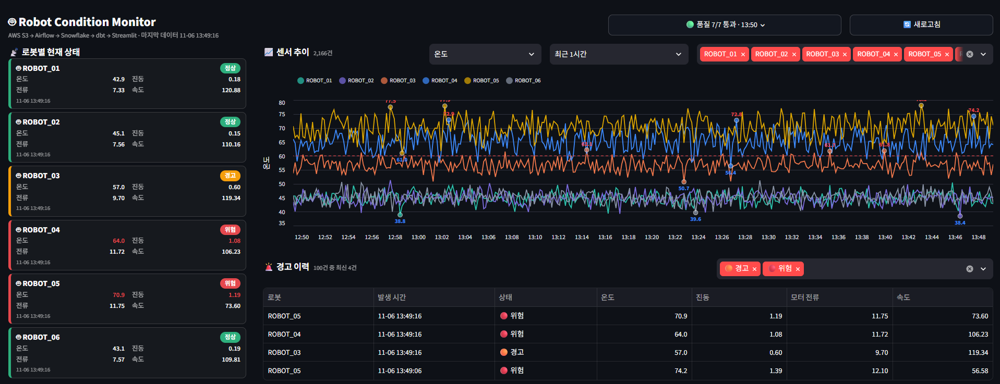
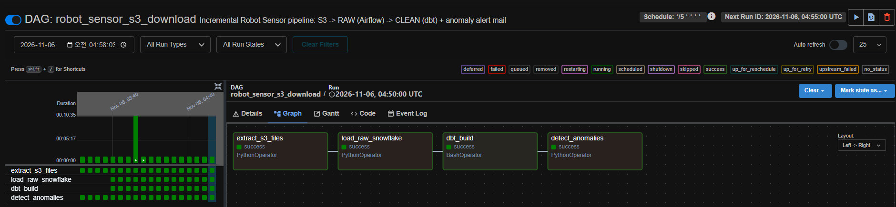
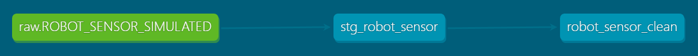

# Robot Data Platform

로봇 센서 데이터를 수집·정제하고, 데이터 품질을 검증하며, 이상 징후를 자동으로 알리는 데이터 파이프라인입니다.

## 아키텍처

EC2 시뮬레이터 → S3 → Airflow → Snowflake(RAW) → dbt(CLEAN + 품질 테스트) → Streamlit / 알람 메일

| 구성 요소 | 역할 |
|---|---|
| EC2 시뮬레이터 | 로봇 6대의 센서 데이터를 10초마다 생성하고, 1분마다 S3에 CSV로 업로드 |
| Airflow | 5분마다 새 파일을 찾아 RAW에 적재, dbt 실행, 이상 징후 메일 발송 |
| Snowflake | RAW / CLEAN 테이블, 테스트 결과와 알람 이력 저장 |
| dbt | RAW → CLEAN 정제(중복 제거, 필수값 검증)와 품질 테스트 9개 |
| Streamlit | 로봇 상태, 센서 추이, 경고 이력, 데이터 품질 배지 |

## 주요 설계

- **증분 처리:** 처리한 S3 파일을 기록하고, EVENT_ID 기준 MERGE로 재실행해도 중복이 생기지 않습니다.
- **데이터 품질:** 원본(staging)의 null은 경고로, 최종 테이블(CLEAN)의 중복·잘못된 상태값은 실패로 처리합니다. 테스트가 실패하면 알람 단계가 실행되지 않습니다.
- **품질 이력:** 매 실행의 테스트 결과를 `DBT_TEST_RESULTS`에 쌓아 대시보드에서 추이를 확인합니다.
- **알람:** WARNING/DANGER를 로봇별로 묶어 메일 한 통으로 보내고, 같은 이상은 30분 쿨다운으로 반복 발송을 막습니다.

## 화면

| Airflow DAG | dbt 리니지 |
|---|---|
|  |  |

## 기술 스택

Python · AWS (EC2, S3) · Apache Airflow · Snowflake · dbt · Streamlit · Docker